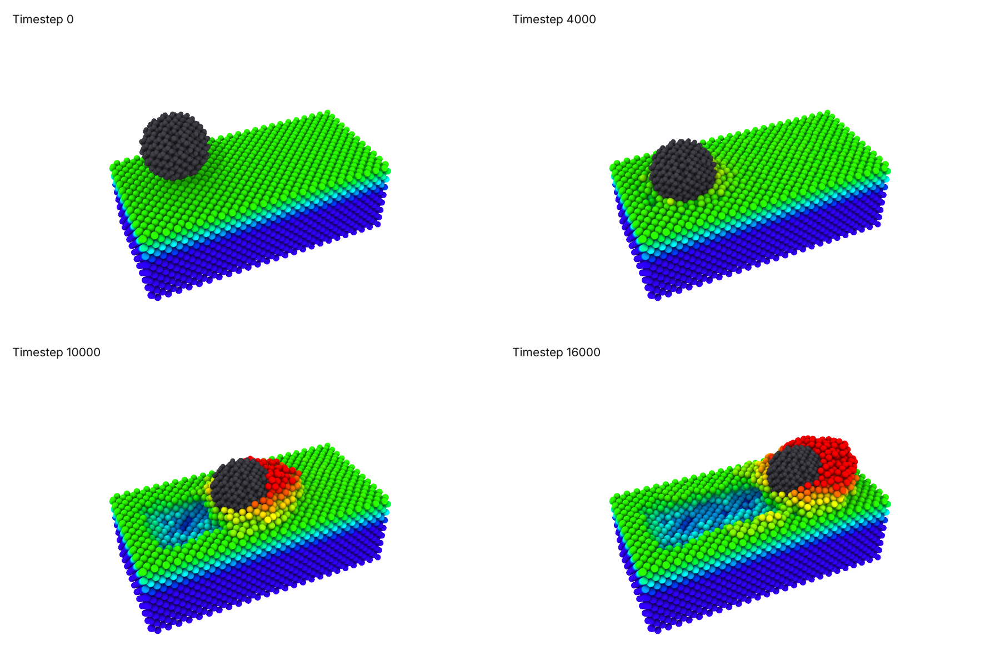

# 3D machining of aluminium with a spherical tool: LAMMPS + OVITO

A rigid spherical diamond tool sinks into the top surface of an aluminium workpiece,
then moves along the X-axis. It ploughs out a groove and pushes the removed material
up into a chip in front of it.



## Deliverables

| File | What it is |
|---|---|
| `machining.in` | LAMMPS input file |
| `Al_mm.eam.fs` | Al EAM potential used by the input (ships with LAMMPS) |
| `machining.lammpstrj` | dump file: 33 frames, one every 1 ps (open in OVITO) |
| `log.lammps` | LAMMPS log of the run (forces on the tool, temperature) |
| `ovito/machining.gif` | OVITO animation of the whole run |
| `ovito/machining_steps.png` | OVITO 3D views at 4 moments: start, penetration, mid-cut, end |
| `ovito/machining_3d.png` | OVITO 3D view at the end, Al coloured by height |
| `ovito/machining_slice.png` | OVITO cross-section through the tool path (crystal structure) |
| `ovito_render.py` | script that produced the OVITO images |

## Setup

| Item | Value |
|---|---|
| Workpiece | Al single crystal, 10.1 × 3.2 × 4.9 nm (X × Y × Z), 9,600 atoms, Y is up |
| Tool | rigid sphere of diamond atoms, radius 1.2 nm, 1,276 atoms |
| Tool path | starts 0.4 nm above the surface, moves down to 0.8 nm depth, then 5 nm along +X |
| Tool speed | 200 m/s (2 Å/ps) for both stages |
| Potentials | Al–Al: EAM (Mendelev 2008); Al–C: Morse (D₀ = 0.28 eV, α = 2.78 Å⁻¹, r₀ = 2.2 Å) |
| Timestep | 2 fs; 1 ps equilibration at 300 K, 6 ps penetration, 25 ps machining |

**Boundary conditions:**
- **Fixed:** a 0.4 nm layer at the bottom and on all four sides. Forces and
  velocities there are zero, which prevents rigid-body motion.
- **Heat sink:** the next 0.4 nm inside the fixed layers is held at 300 K. It soaks
  up the heat from machining, as the surrounding bulk would in a real part.
- **Free:** all other Al atoms move freely (NVE) in response to the tool.

## Results

- **Material removal:** the tool leaves a groove about 0.8 nm deep, and the displaced
  aluminium piles up ahead of the tool as a chip. It also forms small ridges along the groove.
- **Forces during machining (mean):** about 32 nN resisting the tool along X, and about
  19 nN pushing it up.
- **Temperature:** the free region stays at about 390 K.
- **Runtime:** 2 min 11 s on 4 cores.

## Viewing the dump in OVITO

1. **File → Load File** and choose `machining.lammpstrj`. All 33 frames load as an
   animation; Al and C are named automatically.
2. OVITO treats Z as up, but this simulation uses Y. To get a natural view, add
   **Affine transformation** with the rotation matrix rows `1 0 0 / 0 0 -1 / 0 1 0`,
   or simply rotate the camera.
3. Optional modifiers:
   - **Color coding** on `Position.Y` (height) shows the groove and the chip.
   - **Common neighbor analysis** shows the crystal (green) and the disordered chip (white).
   - **Slice** through the middle of the width shows the side view.

To re-create the images: `pip install ovito`, then `python ovito_render.py machining.lammpstrj`.
On a headless Linux machine, also install `mesa-vulkan-drivers`.

## Running the simulation

```bash
pip install lammps mpich
```

```bash
mpirun -np 4 lmp -in machining.in
```

Run it in a folder that contains `machining.in` and `Al_mm.eam.fs`. It writes
`machining.lammpstrj`, `log.lammps` and `final.data`.
